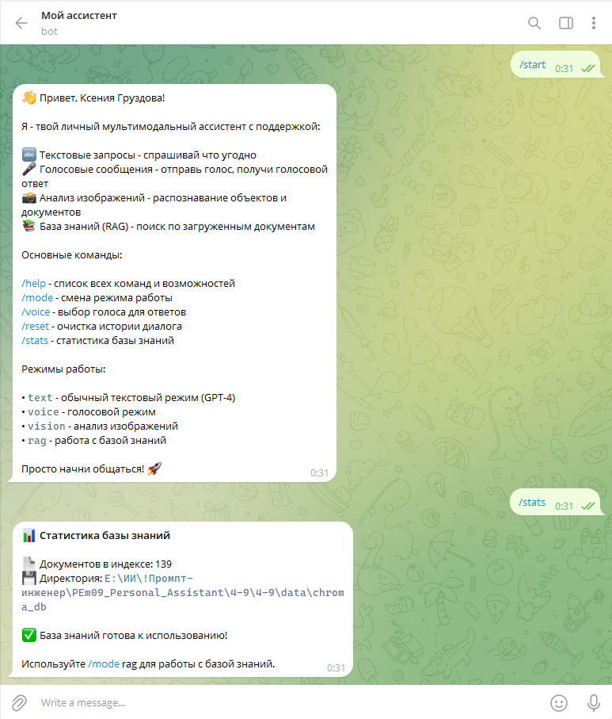
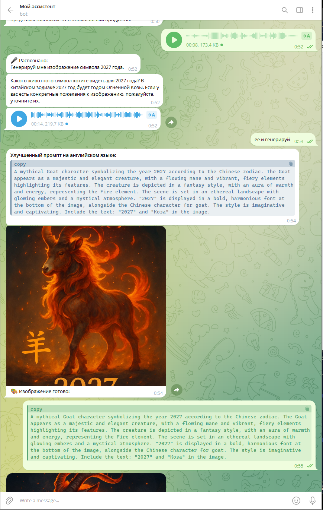
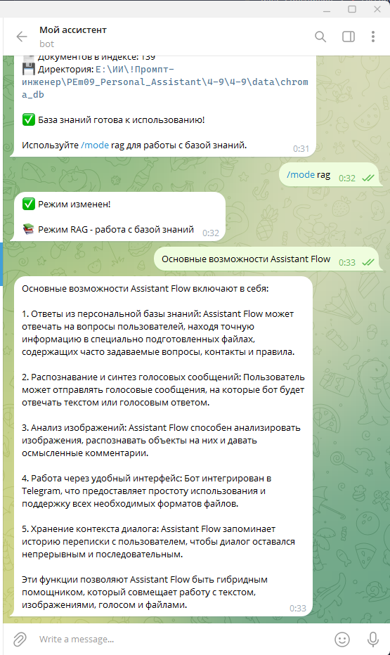

# Personal Assistant — Telegram-бот с OpenAI и RAG

Личный Telegram-ассистент для текстовых и голосовых диалогов, анализа фотографий, поиска по документам и генерации изображений. Запросы к OpenAI отправляются напрямую на `https://api.openai.com/v1`. Ключи читаются из файла `.env` в корне проекта.

## Возможности

- **Текстовый диалог:** ответы на вопросы с учётом истории разговора.
- **Голос:** распознавание голосовых сообщений и озвучивание ответов.
- **Анализ фотографий:** описание изображения, ответы на вопросы к нему и извлечение видимого текста.
- **RAG:** поиск по локальным документам с использованием ChromaDB и LangChain.
- **Генерация изображений:** ИИ определяет намерение пользователя по смыслу запроса и истории диалога. Перед готовой фотографией бот отправляет улучшенный промпт на английском — точный текст, переданный генератору.

## Скриншоты и описание экранов

Примеры работы бота в Telegram и журнал запуска находятся в папке `screenshots/`. Числа и пути на снимках относятся к демонстрационному запуску.

### Приветствие и статистика базы знаний

После `/start` бот показывает свои возможности, основные команды и доступные режимы. Команда `/stats` выводит размер индекса и путь к ChromaDB. На снимке указано 139 записей — это количество фрагментов документов, а не исходных файлов.



### Текстовый диалог

Команда `/mode text` включает текстовый режим. На экране бот отвечает на вопрос о своих возможностях, затем обсуждает полёт к Луне и учитывает уточнение пользователя в следующем сообщении.


### Голосовое общение

После `/mode voice` пользователь отправляет голосовой вопрос о полётах на Марс. Бот показывает распознанный текст, формирует ответ и присылает его озвученную версию.


### Анализ фотографии

В режиме `/mode vision` пользователь отправляет изображение робота с вопросом в подписи. Бот анализирует фотографию и описывает внешний вид персонажа: форму, цвета и детали.


### Генерация изображения по диалогу

Пользователь голосом просит создать изображение символа 2027 года, затем текстом подтверждает выбор персонажа. Бот использует контекст разговора, отправляет улучшенный промпт на английском языке, а следом — готовое изображение огненной козы.



### Ответ по документам в режиме RAG

После `/mode rag` пользователь спрашивает об основных возможностях Assistant Flow. Бот отвечает на основе проиндексированного учебного материала: описывает базу знаний, голосовые сообщения, анализ изображений и хранение контекста.



## Требования

- Python 3.12 — версия, на которой проверено текущее окружение проекта.
- Токен Telegram-бота, созданного через [BotFather](https://t.me/BotFather).
- Действующий ключ OpenAI с доступом к используемым моделям и доступным лимитом API.
- Сетевой доступ к Telegram и OpenAI.
- FFmpeg в `PATH` для преобразования голосовых сообщений из OGG в WAV.
- Для PDF без текстового слоя на Windows — доступный язык распознавания OCR (по умолчанию русский). Используются встроенные средства Windows.

## Установка

Выполняйте команды из корня проекта, где находятся `main.py` и `requirements.txt`. Если окружение `venv` уже установлено, переходите к настройке `.env` и запуску.

### Windows PowerShell

```powershell
py -3.12 -m venv venv
.\venv\Scripts\python.exe -m pip install -r requirements.txt
```

Для установки и запуска можно использовать интерпретатор окружения напрямую, без активации. Если нужна активация в текущем терминале:

```powershell
.\venv\Scripts\Activate.ps1
```

### Linux / macOS

```bash
python3.12 -m venv venv
./venv/bin/python -m pip install -r requirements.txt
source venv/bin/activate
```

Для голосовых сообщений установите FFmpeg способом, подходящим вашей ОС, и проверьте доступность команды:

```text
ffmpeg -version
```

## Настройка `.env`

Скопируйте [.env.example](.env.example) в `.env` рядом с `main.py` и заполните ключи, либо отредактируйте существующий `.env`. Пример с заполнителями вместо настоящих ключей:

```dotenv
TELEGRAM_BOT_TOKEN=your_telegram_bot_token
OPENAI_API_KEY=your_openai_api_key

OPENAI_MODEL=gpt-4o
OPENAI_VISION_MODEL=gpt-4o
OPENAI_IMAGE_MODEL=gpt-image-1
OPENAI_IMAGE_SIZE=1024x1024
OPENAI_IMAGE_QUALITY=medium

BOT_MODE=text
DEFAULT_VOICE=alloy
LOG_LEVEL=INFO
PDF_OCR_LANGUAGE=ru
```

Обязательны `TELEGRAM_BOT_TOKEN` и `OPENAI_API_KEY`. Настройки моделей в примере соответствуют значениям по умолчанию в [config.py](config.py). Для текстовой модели требуется поддержка вызова инструментов: через неё бот выбирает между текстовым ответом и генерацией изображения.

`BOT_MODE` задаёт режим, который устанавливается командой `/start`: `text`, `voice`, `vision` или `rag`. Доступные голоса: `alloy`, `echo`, `nova`, `fable`, `onyx`, `shimmer`. Стандартные размеры GPT Image: `1024x1024`, `1024x1536`, `1536x1024`; значения качества: `low`, `medium`, `high`, `auto`.

Файл `.env` выбирается относительно `config.py`, независимо от рабочей папки запуска. Ключи берутся именно из этого файла; одноимённые системные переменные их не подменяют. `.env` включён в `.gitignore` — не публикуйте его содержимое.

## Запуск

В Windows:

```powershell
.\venv\Scripts\python.exe main.py
```

В Linux / macOS:

```bash
./venv/bin/python main.py
```

При активированном окружении достаточно `python main.py`. После изменения `.env`, кода или добавления документов в папку базы знаний перезапустите процесс. Остановка — `Ctrl+C`.

После запуска откройте своего бота в Telegram и отправьте `/start`. В журнале сообщение `Starting bot polling...` означает, что бот начал получать обновления. Журнал выводится в консоль и записывается в `bot.log`.

## Команды Telegram

- `/start` — приветствие и установка начального режима.
- `/help` — справка по функциям бота.
- `/mode` — текущий режим и список доступных режимов.
- `/mode text` — обычный текстовый диалог.
- `/mode voice` — озвучивание ответов на текстовые сообщения.
- `/mode vision` — режим для работы с изображениями; фотографии также обрабатываются в других режимах.
- `/mode rag` — ответы с поиском по базе знаний.
- `/image описание` — явный запрос на создание картинки.
- `/voice nova` — выбор голоса; вместо `nova` можно указать другой доступный голос.
- `/voices` — список голосов.
- `/reset` — очистка истории диалога пользователя.
- `/stats` — количество фрагментов в индексе и путь к базе ChromaDB.

Голосовые сообщения распознаются в любом режиме. Если голосом запрошено изображение, бот отправляет распознанный текст, английский промпт и фотографию. Для анализа изображения отправляйте его как **фото**, при необходимости с вопросом в подписи.

## Генерация изображений

Специальная команда необязательна. Например:

```text
Нарисуй рыжего кота в скафандре на Луне в акварельном стиле.
Сделай открытку с надписью «С днём рождения!».
Нужна красивая обложка к этому посту.
```

Последний запрос использует предыдущий разговор о посте. Модель готовит самостоятельное описание изображения на английском. Запрошенные надписи и имена собственные сохраняются на исходном языке.

Порядок сообщений:

1. **Улучшенный промпт на английском языке** — полный промпт, использованный для генерации. Длинный текст разбивается на несколько сообщений.
2. Готовое изображение в виде фотографии.

Вопросы вроде «Как нарисовать кота?» или просьбы «Не рисуй, напиши только промпт» обрабатываются как текст. Обычный текстовый ответ и решение о вызове генератора формируются одним обращением к текстовой модели. Для создания самой картинки выполняется отдельный запрос к графической модели.

Подробности реализации и дополнительные примеры: [docs/IMAGE_ROUTING.md](docs/IMAGE_ROUTING.md).

## База знаний RAG

Поместите документы в `data/documents/`. Поддерживаются `.txt`, `.md` и `.pdf`; текстовые файлы должны быть в UTF-8. Для PDF сначала извлекается текстовый слой. Если на странице его нет, на Windows страница преобразуется в изображение и обрабатывается встроенным OCR. Распознанные фрагменты сохраняют номер страницы и имя исходного PDF. Качество текста зависит от качества исходных страниц.

Язык OCR задаётся через `PDF_OCR_LANGUAGE` (по умолчанию `ru`) и должен быть установлен в Windows. Результат распознавания кешируется по хешу PDF в `data/ocr_cache/`, поэтому сбой последующей индексации не требует повторного OCR. На Linux / macOS встроенный Windows OCR недоступен: для сканированных PDF сначала добавьте текстовый слой внешней программой распознавания. PDF, из которого не удалось получить ни одного фрагмента, считается ошибкой и будет повторно проверен при следующем запуске; прежние записи файла при этом сохраняются.

При старте бот вычисляет SHA-256 содержимого каждого документа, включая файлы во вложенных папках. Новые файлы разбиваются на фрагменты и индексируются через OpenAI. Для изменённых файлов сначала добавляются новые фрагменты, затем удаляются старые записи этого файла. Неизменённые файлы пропускаются без повторного разбора и запросов к API векторных представлений. Индекс сохраняется в `data/chroma_db/`, хеши и идентификаторы фрагментов — в `data/chroma_db/indexed_files.json`. Затем в Telegram выберите `/mode rag` и задавайте вопросы.

В папке есть три вымышленных набора данных для проверки:

- [sample_workshop.txt](data/documents/sample_workshop.txt) — расписание и правила мастерской «Роса».
- [sample_library.txt](data/documents/sample_library.txt) — каталог и условия выдачи книг библиотеки «Сосна».
- [sample_project_notes.txt](data/documents/sample_project_notes.txt) — план учебного проекта «Маяк».

Примеры запросов в режиме RAG:

```text
Когда в мастерской «Роса» проходит занятие по акварели?
На сколько дней можно взять книгу в библиотеке «Сосна»?
Кто отвечает за сборку PDF в проекте «Маяк»?
Сделай афишу мастерской «Роса» по данным из базы знаний.
```

Для афиши модель получает найденные фрагменты документов и использует их при подготовке английского промпта. Если подходящих сведений нет, бот использует общий ответ с уведомлением об отсутствии данных в базе.

В текущей версии документы добавляются через папку `data/documents/`: автоматическая индексация файлов, присланных в Telegram, не подключена. В журнале показываются имена пропущенных файлов и итоговые счётчики `new`, `updated`, `skipped`, `failed`. Если обработка одного файла завершилась ошибкой, остальные продолжают индексироваться; неудачная обработка будет повторена при следующем запуске.

При первом запуске после включения учёта хешей файлы индексируются один раз, а их старые фрагменты по тем же путям, в том числе дубликаты, заменяются. Далее повторно обрабатываются только новые или изменённые файлы. Изменение настроек разбиения или модели векторных представлений также требует обновления записей. Удаление или перенос исходного файла само по себе не удаляет записи по его прежнему пути из базы. `/stats` показывает число фрагментов, поэтому оно может превышать количество файлов.

Индекс сохраняется между запусками и является общим для всех пользователей этого экземпляра бота. История диалога разделена по пользователям и хранится в оперативной памяти: до 20 сообщений на пользователя. При перезапуске история теряется; `/reset` очищает историю, но не индекс документов.

## Структура проекта

```text
main.py                     Запуск, регистрация обработчиков и polling
bot.py                      Экземпляр Telegram-бота
config.py                   Загрузка .env и настройки
requirements.txt            Зависимости Python
handlers/                   Команды, текст, голос, фото и отправка картинок
services/                   Клиент OpenAI, маршрутизация, STT, TTS, генерация
rag/                        Загрузка документов, индекс и поиск
utils/                      История диалога, работа с файлами и журнал
data/documents/             Исходные документы базы знаний
data/chroma_db/             Сохранённый векторный индекс
data/ocr_cache/             Локальный кеш распознанных страниц PDF
data/generated_images/      Временные изображения генератора
tests/                      Проверки поведения
screenshots/                Скриншоты работы бота для README
docs/IMAGE_ROUTING.md        Описание автоматической генерации изображений
```

Созданные изображения удаляются из временной папки после попытки отправки в Telegram.

## Проверки

Следующий набор проверяет текстовую маршрутизацию, RAG, генерацию и отправку изображений, порядок «промпт → фото» и форматирование `/stats`. Внешние вызовы OpenAI и Telegram подменяются:

```powershell
.\venv\Scripts\python.exe -m pytest -q tests/test_image_generation.py tests/test_text.py tests/test_rag.py tests/test_incremental_index.py tests/test_pdf_ocr.py tests/test_stats_handler.py
```

Для проверки совместимости установленных зависимостей:

```powershell
.\venv\Scripts\python.exe -m pip check
```

В Linux / macOS замените путь интерпретатора на `./venv/bin/python`. Полный набор также содержит аудиотесты в `tests/test_stt.py`, часть которых может обращаться к API; приведённая команда запускает только выбранные проверки.

## Если что-то не работает

- **OpenAI возвращает `401`:** проверьте `OPENAI_API_KEY` в корневом `.env` и перезапустите бота.
- **Ошибка лимита или баланса:** проверьте доступные средства и ограничения проекта OpenAI. Генерация изображений, речь и векторные представления документов используют API.
- **Модель недоступна:** проверьте доступ API-проекта к модели, указанной в соответствующей переменной `.env`.
- **Тайм-ауты:** проверьте соединение с OpenAI и Telegram с компьютера, где работает бот.
- **Голосовые сообщения не распознаются:** убедитесь, что `ffmpeg -version` выполняется в том же терминале, и перезапустите процесс после изменения `PATH`.
- **Документ не находится:** проверьте формат и кодировку, сообщения об индексации в `bot.log`, затем выберите `/mode rag`.
- **Для PDF получено `0 chunks`:** обновлённый загрузчик повторно обработает такой файл через OCR на Windows. При ошибке OCR проверьте доступность языка `PDF_OCR_LANGUAGE` в языковых настройках Windows; пустой результат не помечается как успешная индексация.
- **Ошибка Telegram `can't parse entities`:** проверьте разметку конкретного обработчика. Ответ `/stats` и английские промпты отправляются с экранированием HTML; остальные ответы используют настройки форматирования своих обработчиков.
